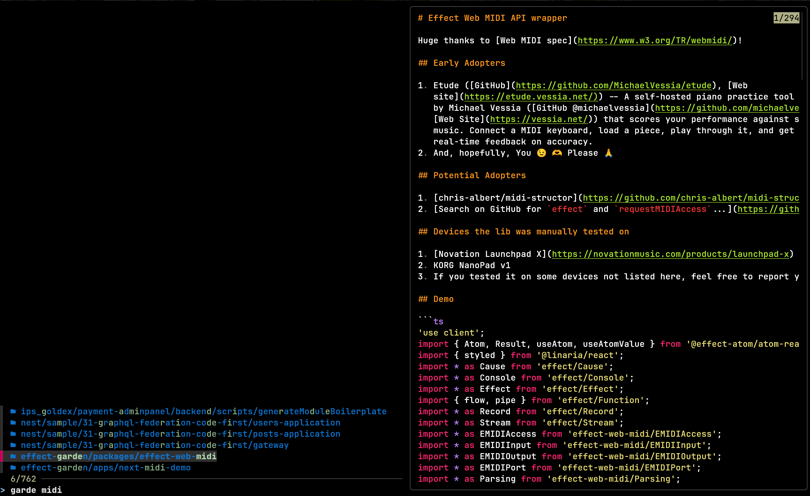
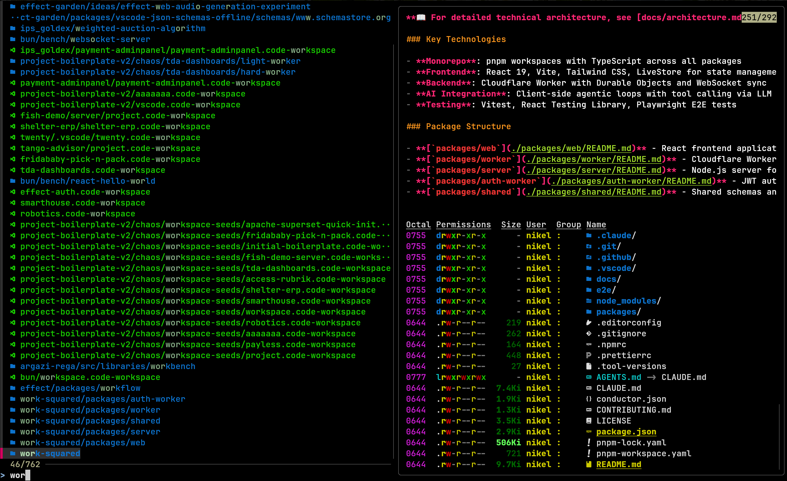

# @evadev/qcode

A keyboard-shortcut-triggered fuzzy project opener for VS Code, opencode, or shell. It
recursively scans `~/projects` for project roots (detected via `.git`,
`.vscode`, `package.json`, `mise.toml`, or `.code-workspace` files) while
skipping noisy dirs like `node_modules`, `dist`, etc. The results are piped into
`fzf` with a live preview panel that shows the project's README (via `bat`) and
a rich directory listing (via `eza`). Selecting an entry opens it with the
configured opener.

**Runtime dependencies:** `fzf`, `eza`, `bat`. Optionally `bfs` for faster
directory traversal (falls back to `find`).

## Icon customization

The picker uses Nerd Font icons by default. If those glyphs render correctly in
your terminal but appear incorrectly inside `fzf`, or if you prefer different
icons, override them with environment variables:

```bash
QCODE_DIR_ICON='🗀' \\
QCODE_WORKSPACE_ICON='▣' \\
bun index.ts --opener shell
```

`QCODE_DIR_ICON` and `QCODE_WORKSPACE_ICON` replace the directory and workspace
icons respectively. This is a rendering compatibility option for environments
where Nerd Font PUA glyphs do not display as expected inside `fzf`.

To install only `node_module` deps (the binaries from above must be present):

```bash
bun install
```

To use:
```bash
# I assigned a keybinding in GNOME to ctrl+alt+r
kitty --single-instance /home/nikel/.local/share/mise/installs/bun/latest/bin/bun /home/evadev/projects/effect-garden/one-offs/qcode/dist/minified/index.mjs

# or a shorter version if you want to see the result without build step
bun index.ts
```

## Openers

The default command (no subcommand) accepts an `--opener` flag that controls
what happens with the project selected in `fzf`:

```bash
# default: open the selected project in VS Code (`code <projectPath>`)
bun index.ts --opener vscode

# drop into an interactive shell rooted at the selected project,
# in the same terminal window
bun index.ts --opener shell

# launch opencode rooted at the selected project,
# in the same terminal window
bun index.ts --opener opencode
```

- `vscode` (default): launches `code` with the resolved project path and exits.
  Requires the `code` binary on `PATH`.
- `shell`: spawns `$SHELL` (falls back to `bash`) with stdio inherited and `cwd`
  set to the resolved project directory, so you stay in the same terminal
  window. If the selection is a `.code-workspace` file, `cwd` is its parent
  directory. The shell runs until you exit it, then `qcode` exits 0.
- `opencode`: launches `opencode <projectDir>` with stdio inherited and `cwd`
  set to the resolved project directory, so you stay in the same terminal
  window. If the selection is a `.code-workspace` file, the parent directory
  is used. Requires the `opencode` binary on `PATH`.

  Ctrl+Z stays harmless here. opencode suspends itself by handing the terminal
  back and waiting for `SIGCONT` — but in a `kitty --single-instance` window
  there is no shell, so the process group kitty gives `qcode` is orphaned and
  the kernel drops the stop request altogether. The result used to be a blank
  window with nothing actually stopped (and nothing to resume it). While
  opencode runs, `qcode` watches the terminal and sends that `SIGCONT` itself,
  so Ctrl+Z shows up as a ~50 ms flicker instead of a dead window. `--opener
  shell` is deliberately left alone: a real shell resumes its own jobs, so
  Ctrl+Z there stays a real suspend.

## Partial-PATH launches (kitty shortcut)

When `qcode` is launched directly (e.g. via a `kitty --single-instance`
shortcut) instead of from an interactive shell, `.bashrc` never runs and
`PATH` may miss entries like `~/.bun/bin` — so `opencode` fails with "not
found" even though it works from a manually opened terminal.

To fix, run once from a terminal with a full `PATH`:

```bash
bun index.ts cache-path
```

This saves the current full `$PATH` to `~/.cache/qcode/PATH.txt`, then exits
without opening `fzf`.

Later launches read that file. If no cache file exists the command spawns
unchanged. Spawning with the full `PATH` instead of an absolute binary path also
fixes `opencode`'s first launch: the `opencode` process itself gets the full
`PATH`, so its daemon children (MCP binaries like `effect-mcp` from bun deps)
inherit it too.

Running the bundled and minified version produces the fastest startup times.

Build and minify with `bun run build`

## Demo

|  |  |
| ----------------------------- | ----------------------------- |
